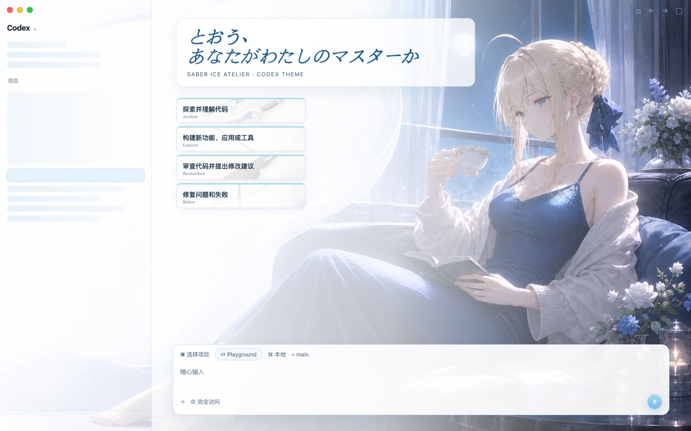
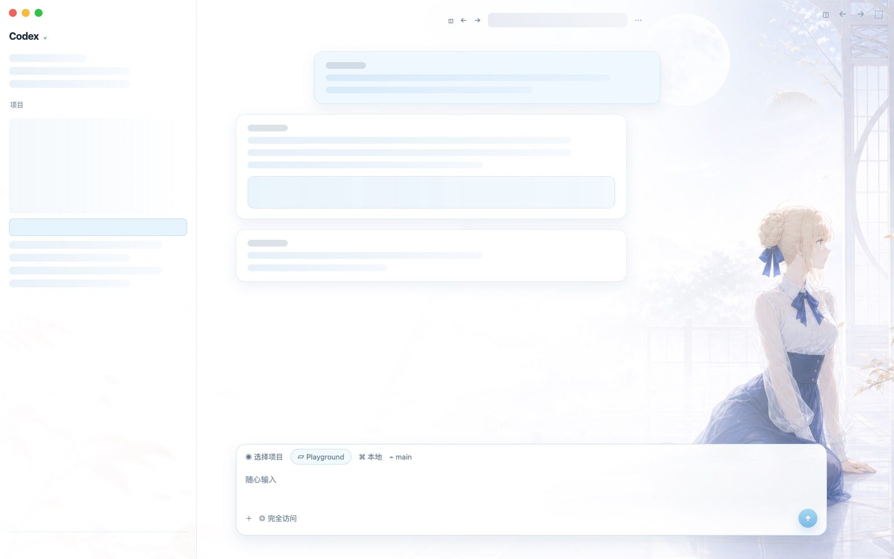
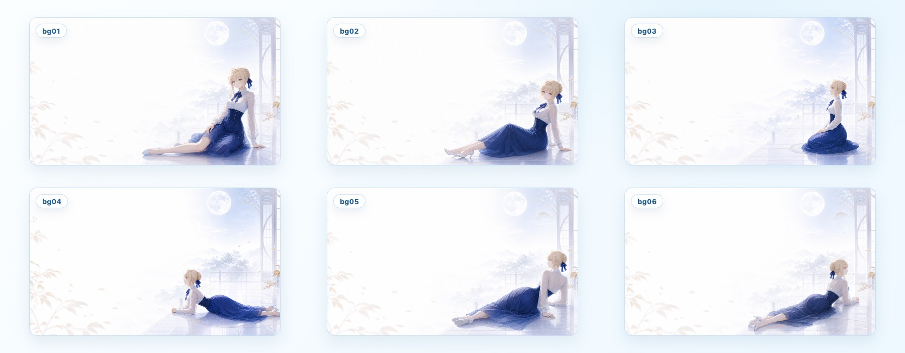
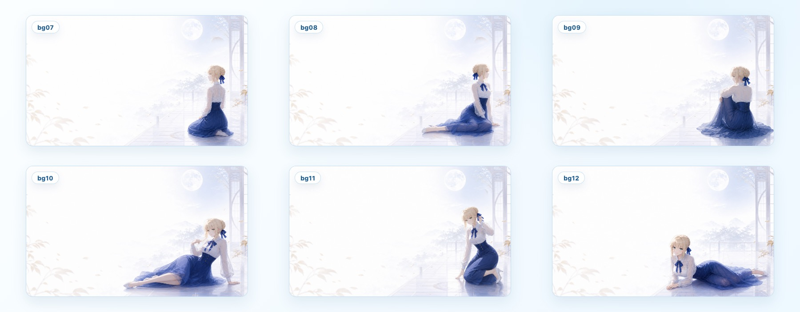

# Codex Saber Theme

[中文](./README.md)

A macOS Codex theme repository designed to be installed and maintained directly by AI / Codex.

The repository includes the complete theme engine and Saber assets. No separate theme tool is required, and the official Codex application files are never modified.

Current version: `0.0.1`

## Preview

### Home



### Chat



### Background rotation





## Use

Open this repository in Codex and send:

```text
Read AGENTS.md in the repository root, install and enable Codex Saber Theme, then verify that it works. Do not modify the official Codex application files. Ask for my confirmation before restarting Codex.
```

Codex will follow [`AGENTS.md`](./AGENTS.md) to test, install, activate, and verify the theme.

## Requirements

- macOS
- Official Codex Desktop installed
- Codex launched at least once

The engine is installed at `~/.codex/codex-saber-theme`. Existing themes and backups remain in the compatible state directory.

## Restore

Ask Codex:

```text
Follow AGENTS.md to restore the official Codex appearance.
```

## Source and license

This project builds on the theme engine from [Dream Skin Studio (Fei-Away/Codex-Dream-Skin)](https://github.com/Fei-Away/Codex-Dream-Skin).

Software code is provided under the [MIT License](./LICENSE). Saber, Rin, Archer, related character designs, and third-party artwork are outside the software license. See [NOTICE.md](./NOTICE.md).

Development, troubleshooting, and manual commands are documented in [`macos/README.md`](./macos/README.md).
