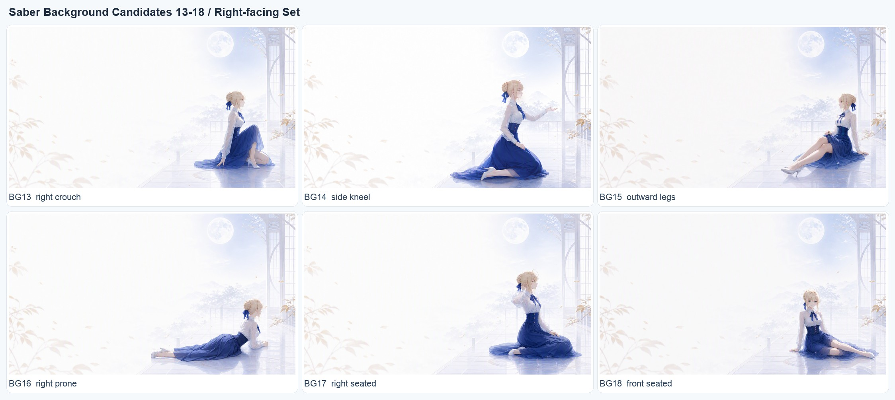
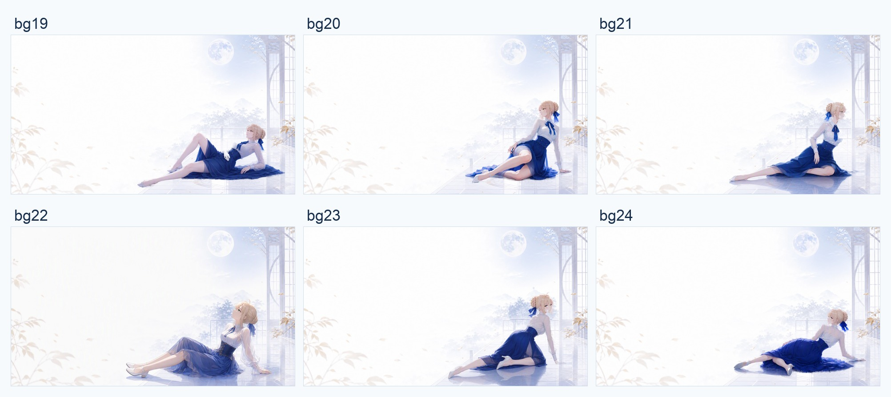
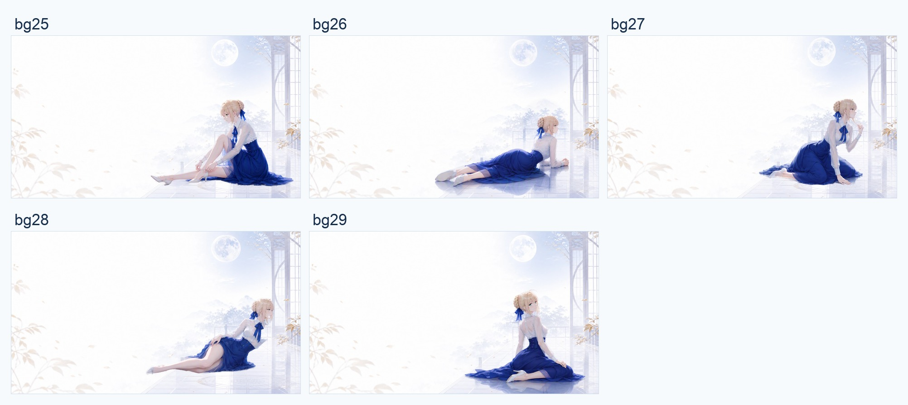

# Codex Saber Theme

官方 Codex 桌面应用的 Saber 主题，提供 macOS 原生应用启动器和 Windows 桌面／开始菜单入口。

仓库已经包含主题引擎和 Saber 主题资源，不需要另外安装其他主题工具，也不会修改官方 Codex 应用文件。

当前版本：`0.1.0` · [下载发布包](https://github.com/nightosong/codex-saber-theme/releases/tag/v0.1.0)

## 预览

### 首页


### 聊天页


### 背景轮换








## 使用

| 平台 | 首次安装 | 日常启动 |
| --- | --- | --- |
| macOS | 解压 macOS 发布 ZIP，把其中的 `Saber Theme.app` 拖到“应用程序” | 双击 `Saber Theme.app`，可固定到 Dock |
| Windows | 解压完整 Windows 发布包，双击 `windows/Install Saber Theme.cmd` | 点击桌面／开始菜单的 `Saber Theme`，可固定到任务栏 |

macOS 应用内置引擎，可单独分发；首次安装和更新需要关闭 Codex 时会先确认。仓库源码用户也可以先关闭 Codex，双击 `macos/Install Codex Saber Theme.command`，安装后启动入口位于 `~/Applications/Saber Theme.app`。

Windows 需要官方应用附带的 Node.js，或已安装的官方签名 Node.js 22+。Windows 实际应用启动与界面效果仍待真机验收，详情见 [Windows 使用说明](windows/README.md)。

当前发布构建采用本地签名，尚未配置 Apple Developer ID 签名及公证；其他 Mac 可能需要在系统设置中允许打开。正式公开发行可使用开发者签名并另行完成公证。

也可以让 Codex 协助安装：

将本仓库交给 Codex，然后发送：

```text
请读取仓库根目录的 AGENTS.md，安装并启用 Codex Saber Theme，完成后验证主题是否正常。不要修改官方 Codex 应用文件；如果需要重启 Codex，先征得我的确认。
```

Codex 会根据 [`AGENTS.md`](./AGENTS.md) 完成测试、安装、主题切换和验证。

## 要求

- macOS 或原生 Windows
- 已安装官方 Codex Desktop
- 官方 Codex 至少启动过一次

macOS 主题程序安装在 `~/.codex/codex-saber-theme`；Windows 安装在 `%LOCALAPPDATA%\CodexSaberTheme`。已有主题和备份保留。

启动器默认完成一次注入后退出；直接点击原版应用图标、完整刷新页面或新开窗口后，可能需要再次点击 Saber Theme。主题不会安装成官方应用内部的 CSS 扩展。

## 轮播与性能

保留全部 30 张壁纸，轮播库使用压缩二进制资源，图片传输与常驻脚本分离。仅为当前／过渡中的轮播图片创建 Blob URL；窗口隐藏时暂停轮播，恢复后等待正常间隔，不补播。过渡完成后清空隐藏覆盖层；预加载超时、失败、重新注入和卸载均清理资源。

测试覆盖 2,000 次模拟轮播、200 次重复注入，以及隔离 Chromium 的真实 4K 图片轮播。检测范围及复现方式见 [性能验证说明](docs/performance/README.md)。测试不等于已经排除整个 Codex 应用的所有内存或 GPU 问题。

## 构建发布包

在 macOS 仓库根目录执行：

```bash
macos/scripts/build-client-release.sh
macos/scripts/build-windows-release.sh
```

GitHub Actions 也会构建 macOS 应用 ZIP、检查 Windows 启动器并输出平台构件。

版本以 `macos/VERSION` 为准；运行时和发布脚本自动读取，测试校验 `package.json`、更新日志和 README 一致。默认生成 `codex-saber-theme-v<版本>-macos.zip` 与 `codex-saber-theme-v<版本>-windows.zip`。

## 仓库开发

本仓库开发时，可以让本机直接使用当前工作区：

```bash
cd macos
./scripts/use-repository-macos.sh
./scripts/apply-repository-theme-macos.sh
```

以后修改主题资源或代码，只需再次运行第二条命令进行本机测试；改动仍完整保留在 Git 工作区中。

## 恢复

需要恢复官方外观时，告诉 Codex：

```text
请按照 AGENTS.md 恢复 Codex 官方外观。
```

## 来源与许可

本项目参考并基于 [Dream Skin Studio（Fei-Away/Codex-Dream-Skin）](https://github.com/Fei-Away/Codex-Dream-Skin) 的主题引擎开发。

软件代码使用 [MIT License](./LICENSE)。Saber、Rin、Archer 等角色形象和第三方美术素材不包含在软件许可中，详见 [NOTICE.md](./NOTICE.md)。

开发、调试和手动命令见 [`macos/README.md`](./macos/README.md)。
