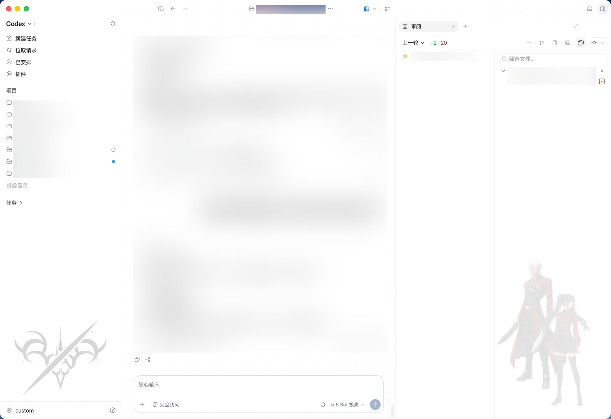

# Codex Saber Theme

一个可以直接交给 AI / Codex 安装和维护的 macOS Codex 主题仓库。

仓库已经包含主题引擎和 Saber 主题资源，不需要另外安装其他主题工具，也不会修改官方 Codex 应用文件。

当前版本：`0.0.1`

## 预览

### 首页


### 任务与审阅



## 使用

将本仓库交给 Codex，然后发送：

```text
请读取仓库根目录的 AGENTS.md，安装并启用 Codex Saber Theme，完成后验证主题是否正常。不要修改官方 Codex 应用文件；如果需要重启 Codex，先征得我的确认。
```

Codex 会根据 [`AGENTS.md`](./AGENTS.md) 完成测试、安装、主题切换和验证。

## 要求

- macOS
- 已安装官方 Codex Desktop
- 官方 Codex 至少启动过一次

主题程序安装在 `~/.codex/codex-saber-theme`。已有主题和备份继续保存在兼容状态目录中。

## 恢复

需要恢复官方外观时，告诉 Codex：

```text
请按照 AGENTS.md 恢复 Codex 官方外观。
```

## 来源与许可

本项目参考并基于 [Dream Skin Studio（Fei-Away/Codex-Dream-Skin）](https://github.com/Fei-Away/Codex-Dream-Skin) 的主题引擎开发。

软件代码使用 [MIT License](./LICENSE)。Saber、Rin、Archer 等角色形象和第三方美术素材不包含在软件许可中，详见 [NOTICE.md](./NOTICE.md)。

开发、调试和手动命令见 [`macos/README.md`](./macos/README.md)。
